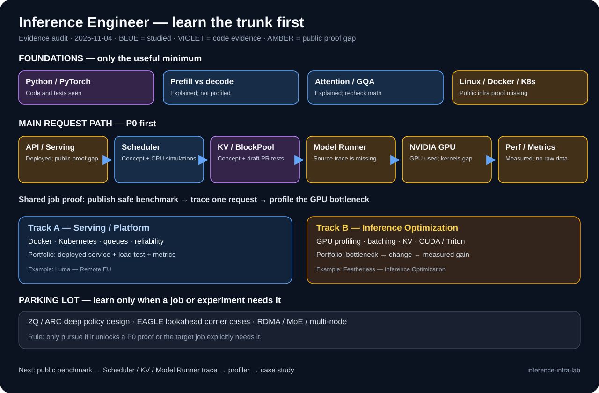
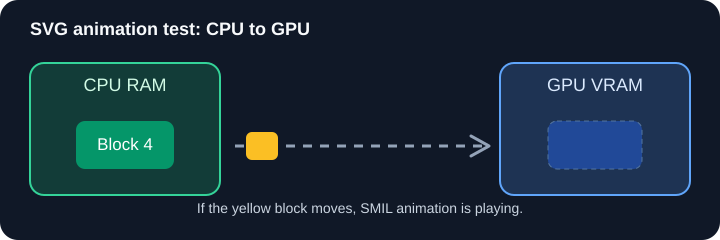
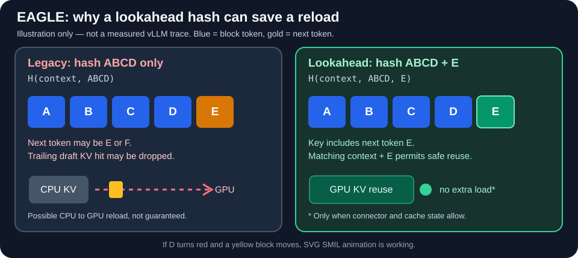

# Inference Infra Lab

A public engineering notebook for learning, testing, and contributing to **LLM inference systems**.

**Focus:** job-ready LLM inference engineering: serving, Scheduler/KV/Model Runner, NVIDIA GPU profiling, performance analysis, and reliable deployment. Specialized topics such as EAGLE/ARC are optional branches.

This repository is not a collection of copied explanations. Each topic should move from **understanding** to **independent explanation**, then to **code and measurement**.

## Start here

**Learn the trunk before the branches.** Aim for a deployable, measurable inference service, not a complete tour of every issue.

- **[SKILL_MAP.md](SKILL_MAP.md)** — full knowledge audit, evidence levels, job-gap ranking, and an 8-week practical plan. **Read this for job focus.**
- **[SKILL_MAP.md](SKILL_MAP.md)** — **start here: visual knowledge map**, evidence levels, P0 trunk, job gaps, and what to skip.
- **[CURRENT.md](CURRENT.md)** — current learning state, open questions, and the next session.
- **[ROADMAP.md](ROADMAP.md)** — skills and engineering gaps.
- **[LEARNING_PROTOCOL.md](LEARNING_PROTOCOL.md)** — the repeatable issue-to-learning workflow and Target → Current → Gap → Action → Feedback loop.
- **[REVIEW_QUEUE.md](REVIEW_QUEUE.md)** — unclear points to retest before new lessons.
- **[Next review quiz](reviews/2026-11-05.md)** — closed-book questions first, no answers in the quiz.
- **[Concepts](concepts/)** — short, testable explanations.
- **[Issues](issues/)** — issue investigations and source references.
- **[Experiments](experiments/)** — reproducible tests and benchmarks. Separate [chat-reported work](experiments/CHAT_REPORTED_RESULTS.md) from rerunnable evidence.
- **[Journal](journal/)** — compact learning history.
- **[Contributions](contributions/)** — verified upstream work and status.

## Job-focused architecture and skill map

Read [SKILL_MAP.md](SKILL_MAP.md) for evidence grades and the two job tracks. We prioritize an end-to-end inference path before rare edge cases.

## SVG animation rendering

We use **animated SVG (SMIL)** for visual learning notes. SVG motion works in this README in our tested browser. Prefer SVG over GIF and keep diagrams directly in Markdown. No GitHub Pages needed.

### KV cache transfer — rendering test

The yellow block moves between CPU and GPU. This is a compatibility test, **not a real transfer-speed trace**.

### EAGLE lookahead hash — concept animation

In the legacy path, the trailing EAGLE draft KV hit may be dropped because the next token is not part of the hash. A lookahead-aware key includes the next token, which can allow safe reuse when supported.

[Read the explanation](visualizations/eagle-lookahead.md). This is a teaching example, not a benchmark.

## Progress means evidence

| Level | Meaning | Evidence |
| --- | --- | --- |
| 0 · Not started | Not studied yet | — |
| 1 · Seen | Recognize the term | Vocabulary notes |
| 2 · Explained | Can explain with a simple example | Written explanation |
| 3 · Verified | Can answer a new question without hints | Self-test / review |
| 4 · Implemented | Can trace and change code, with tests | Commit or test |
| 5 · Measured | Can compare solutions and explain trade-offs | Reproducible benchmark |

**A status applies to one specific skill, not to all of vLLM.** Listening to an explanation is not the same as passing a test.

## Optional research investigation

[vLLM #65161 — EAGLE + CPU KV offloading](issues/vllm-65161.md)

The first task is to confirm whether its original behavior still reproduces on current vLLM. Related changes [#61589](https://github.com/vllm-project/vllm/pull/61589) and [#64096](https://github.com/vllm-project/vllm/pull/64096) have already merged. No fix is claimed here.

**Current job-focused priority:** build a public-safe NVIDIA inference benchmark, trace Scheduler → KV Manager → Model Runner, and profile one measured bottleneck. Previous professional single-GPU deployment experience is acknowledged in [SKILL_MAP.md](SKILL_MAP.md); no private client data belongs here.

## Working rules

1. Check upstream issue, PR, and current source before writing a fix.
2. Define the problem in simple words.
3. Extract and explain missing concepts.
4. Test understanding before calling a topic "verified."
5. Define one concrete knowledge gap and one engineering gap.
6. Reproduce first. Compare correctness, performance, and cost.
7. Record failures and limitations, not only successful results.
8. Avoid company code, customer data, secrets, and private career details.

_Last learning-state update: 2026-11-04._
