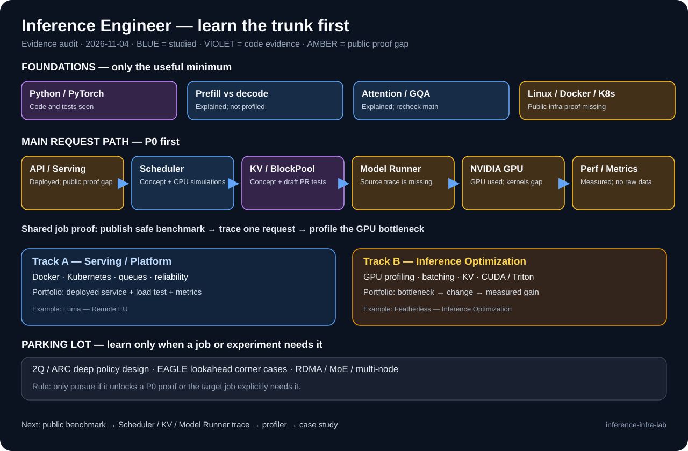

# Roadmap — Job-Ready Inference Engineer

**Updated: 2026-11-04.** Work backward from jobs, not forward from a random issue. See the [animated architecture / knowledge map](SKILL_MAP.md) and [current evidence](CURRENT.md).

## The essential trunk: P0

| Order | Skill to demonstrate | Concrete pass test | Current evidence |
| --- | --- | --- | --- |
| 1 | Basic Transformer/attention, prefill vs decode | Derive K/V size and explain compute-vs-bandwidth with one real model | Explained; independent technical check pending |
| 2 | vLLM request lifecycle: API, Scheduler, KV manager, Model Runner | Trace one prefill and one decode request in current source | Pieces discussed; full trace missing |
| 3 | KV blocks, prefix cache, scheduling, admission/preemption | Reproduce hit/miss, KV shortage, and a scheduler action | Guided concepts; some chat-reported CPU simulations and an open draft core PR |
| 4 | Reproducible NVIDIA inference benchmark | Re-run a public model; publish raw TTFT, TPOT, throughput, GPU memory over varied load | **Prior real deployment and vLLM/SGLang comparison reported; public artifacts missing** |
| 5 | Profiling and reasoning | Explain a measured slowdown and an A/B comparison; include caveats | **Public GPU kernel/CPU profiler trace missing** |
| 6 | Tests, CI, reproducibility | Write regression tests and show commands and failure-before/pass-after | Some reported CPU PR tests; core performance case not yet complete |

**P0 completion is not reading a chapter:** explain independently + source trace + test/measurement artifact. Scores are skill-specific and do not prove overall job readiness.

## Choose a branch after the trunk

### Track A — Serving / platform (e.g., [Luma Remote EU](https://jobs.ashbyhq.com/lumaai/d0f68f86-1ec2-4443-a730-0d8f68842545))

Learn **Linux, Docker, Kubernetes, queues, deployment, observability, reliability and GPU fleet cost**. Build a small deployed inference service and load-test it. These employers expect production systems, not just vLLM issue familiarity.

### Track B — Inference optimization (e.g., [Featherless Remote World](https://jobs.ashbyhq.com/featherlessai/1762b15b-9c0b-4a20-a2b3-ed12c8222156/))

Learn **GPU profiling, CUDA/Triton basics, memory bandwidth, batching, attention/quantization trade-offs**. Build a baseline → profiling → minimal improvement → benchmark case study. This is the deeper GPU track.

## Defer the side quests (P2/P3)

- Full 2Q/ARC implementation or formal policy analysis — know the LRU/2Q/ARC idea, skip full algorithms unless profiling shows eviction is the bottleneck.
- EAGLE lookahead hash, connector corner cases — know how draft/target verification works, then park #65161 if merged fixes remove the original symptom.
- Advanced MoE, NCCL/RDMA, multi-node serving, NPU/Huawei and unusual hardware — do later if a target role explicitly requires them.
- Small unrelated parser/API PRs — useful for OSS practice, but not evidence that can substitute for a GPU inference case.

## Suggested 8-week sequence

| Window | Most valuable deliverable | Pass condition |
| --- | --- | --- |
| Weeks 1–2 | Public-safe NVIDIA baseline (build on prior deployment) | Reproducible setup + TTFT/TPOT/throughput/memory tables with raw data |
| Weeks 3–4 | Vertical source trace + scheduler/KV tests | Explain and instrument a request from API to Model Runner |
| Weeks 5–6 | Profiling diagnosis | Profiling trace + testable bottleneck hypothesis + controlled A/B |
| Weeks 7–8 | One job-shaped portfolio case | Serving deployment **or** measured vLLM core improvement with limitations |

**Existing real-world experience:** the learner reports having deployed and delivered a single-NVIDIA-GPU local LLM service, chosen between vLLM and SGLang using TTFT/TPOT/throughput, and separately benchmarked a PyTorch-to-ONNX conversion. Private customer details and results are not published here. The immediate gap is safe, inspectable evidence and engine-level profiling, **not** learning to launch a model from scratch.

This is a learning plan, not a guaranteed hiring timeline. Adjust based on actual workload and access to GPU resources.

## Issue admission filter

**Start an issue only if** it supports the current P0/P1 proof, has a reproducible setup, can be measured or tested, and has a clear stop condition. Timebox an exploratory issue to one session; move deep research branches into the parking lot. Aim for **70% practical work and 30% just-in-time theory**.

## Audit sources

- [Learning inventory, maturity and evidence gaps](SKILL_MAP.md)
- [Chat-reported tests vs. reproducible artifacts](experiments/CHAT_REPORTED_RESULTS.md)
- [Current knowledge levels and tomorrow's quiz](CURRENT.md)
- [Open personal PRs](contributions/README.md)
