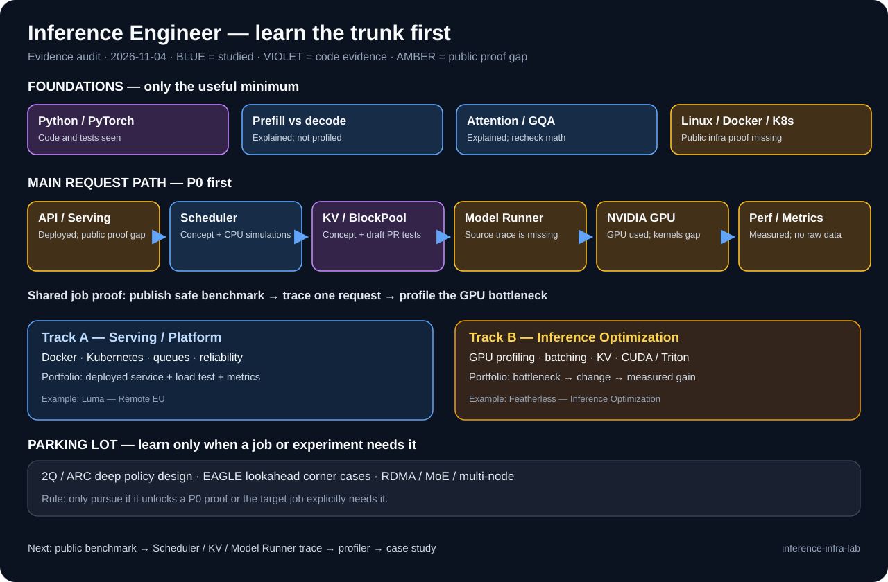

# Inference Engineer Knowledge Map — Evidence Audit

**Date:** 2026-11-04  
**Goal:** Build and operate performant LLM inference systems. Prioritize the job-ready *trunk*, not every interesting open issue.  
**Scope:** Learning discussions and user-reported professional inference work, available public GitHub artifacts, and selected employer role descriptions. This is an evidence audit, not a hiring probability or a claim that all prior conversations and local machines were inspected.

## How to read the status

- **Explained (guided):** discussed and can follow an example; independent transfer may still be untested.
- **Concept checked:** correctly answered a new question or explained the mechanism, but no source-level proof.
- **Engineering evidence:** a concrete PR, local test, or simulation is reported. The work may be AI-assisted. This does **not** automatically verify independent mastery.
- **Unverified:** no sufficient evidence for the specific skill. A user-reported professional deployment can be real while its private logs and benchmark numbers are not in this public repository.
- **Private project safety:** no customer identity, private code, measurements, infrastructure addresses, or confidential details are published here.
- The repo's Level 0–5 scale is **per skill**, not one global score. In particular, a reported performance number without reproducible artifacts is **not Level 5**.

## Inventory: everything covered so far

| Area | Topics already encountered | Understanding / evidence | Next proof | Priority |
| --- | --- | --- | --- | --- |
| Model computation | Prefill vs decode; compute vs bandwidth; TTFT vs TPOT | Explained, not independently retested | Identify the bottleneck using one real serving trace | **P0** |
| Attention basics | MHA, MQA, GQA; attention K/V shapes; basic model weights vs hidden states | Mostly guided; weights-vs-hidden-states had a basic concept check | Derive K/V dimensions and estimate cache bytes for a model | **P0** |
| KV allocation | PagedAttention, logical/physical blocks, BlockPool, free queue, `ref_cnt`, allocation/release | Explained; negative-count guard has reported CPU regression tests in draft PR #64281 | Trace one request's block lifecycle in live code and logs | **P0** |
| Prefix cache | Block hashes, chained context, cache hit/miss, reuse and eviction | Explained; EAGLE boundary condition had a concept-only check | Run hit/miss correctness + latency cases on current vLLM | **P0** |
| Scheduler | Continuous batching, token budget, request queue, admission, preemption, KV shortage | Explained; CPU simulations and tests described in chats | Trace `Scheduler → KV manager → Model Runner`; design one A/B test | **P0** |
| Model Runner | Model input preparation, attention backend, GPU execution path | **Main gap; no verified end-to-end source trace** | Follow one prefill and one decode step through code | **P0** |
| NVIDIA profiling | PyTorch profiler / Nsight, kernel time, H2D, memory, throughput | Prior real NVIDIA single-GPU inference and vLLM/SGLang metrics comparison reported; **no public profiler trace or reproducible benchmark** | Build a new public-safe profiling + benchmark artifact | **P0** |
| Serving / infra | API → queue → vLLM/SGLang, streaming, Linux, Docker, Kubernetes, metrics, CI | User reports personal delivery of a production single-NVIDIA-GPU local LLM service and a mixed local/cloud agent system; **not publicly documented** | Build a sanitized inference-serving case study; add observability / K8s proof | **P0–P1** |
| GPU coding | CUDA/Triton basics, memory hierarchy, basic kernel measurement | Not yet evidenced | Small runnable kernel/profile exercise after baseline profiling | P1 |
| Performance methodology | Reproduction, controlled A/B, P50/P95, request length, concurrency | User reports real vLLM/SGLang TTFT/TPOT/throughput comparison for production selection; recent scheduler studies were synthetic/AI-assisted; neither has publishable raw data here | Design and publish a fresh, controlled, public-safe benchmark | **P0** |
| Open source engineering | GitHub issues/PRs; debugging; CPU tests; error handling; CI | Three own PRs on GitHub, **all open** as of audit; PRs #64281 and #65366 include reported test results | Human code review, repeat local tests, track upstream feedback | P1 |
| Eviction policies | LRU, 2Q, ARC; hot/cold queue; cache promotion bug | Concept explained and AI-assisted local regression reported; not an upstream merged fix | One comparison trace if needed; do not fully implement ARC now | P2 |
| Speculative decode | Drafter/target verification, EAGLE, hidden states, trailing-block drop | Basic acceptance independently answered; EAGLE-specific boundary understood conceptually; code unverified | Review after a delay; resume only if issue supports main-path work | P2 |
| Lookahead/offloading | Lookahead block hash, CPU OffloadingConnector, load vs recompute | Guided explanation; CPU reload path and cost choice not independently traced | Source trace only if it serves P0 profiling goal | P2 |
| Specialized systems | MoE, disaggregated P/D, NCCL, RDMA, multi-node, elaborate quantization, compiler internals | Some terms encountered; no independent operational proof | Add after one single-GPU serving + profiling project | P2–P3 |

**P0 = needed for first credible inference-engineer portfolio. P1 = needed next. P2/P3 = defer until a role or experiment demands it.** A higher priority does not mean a concept is harder.

## GitHub-verified artifacts vs. chat-reported work

### Verified as GitHub artifacts (not merged)
- [PR #61801](https://github.com/vllm-project/vllm/pull/61801): prefix-caching multi-modal documentation fix — **open**.
- [PR #64281](https://github.com/vllm-project/vllm/pull/64281): negative-count guards in BlockPool/free queue — **open draft**. Description reports 337+49 CPU tests and failing-before/passing-after regression cases. No GPU or end-to-end serving test.
- [PR #65366](https://github.com/vllm-project/vllm/pull/65366): DeepSeek V4.1 developer-message error handling — **open**. Description reports 53 combined CPU tests. It is API/tokenizer engineering, **not inference-engine performance**.

### User-reported professional work (real-world experience; private artifacts not in this repo)
- Personally deployed a quantized LLM on an NVIDIA GPU for a production project. Compared vLLM vs. SGLang using TTFT, TPOT and token throughput and selected the better fit. **This corrects the earlier assumption of no real GPU serving experience.** Hardware/model/client details are intentionally omitted from this public repo.
- Independently converted a PyTorch inference path to ONNX and benchmarked it in another professional project. Specific results and benchmark conditions have not been shared here.
- Do not label either effort "not performed". Label the public evidence as **unavailable** until a safe reproduction or a published case study exists.

### Chat-reported recent learning experiments, not independently reproduced in this repository
- A 2Q/ARC cache-hit promotion regression and local minimal fix around [upstream PR #40270](https://github.com/vllm-project/vllm/pull/40270); upstream PR is not authored by this learner.
- Scheduler/admission simulations with roughly 32K KV-token capacity and workloads up to 120 requests; findings depend heavily on input/output lengths and concurrency.
- A CPU synthetic preemption/resume case estimated prefix reuse reduced recomputation from 240 to 112 tokens (not measured GPU speedup).
- Additional reported experiments include a BlockPool lookup microbenchmark and a GQA tuning comparison. Raw files, commands, environments, and repetitions need to be imported before any results can be counted as durable measurement evidence.

See [chat-reported experiment inventory](experiments/CHAT_REPORTED_RESULTS.md). Do not promote an unverified result into a measured engineering claim.

## Which job are we preparing for?

**Shared job-ready trunk (do this first):** Python/PyTorch → vLLM request path → Scheduler/KV/Model Runner → NVIDIA GPU serving → TTFT/TPOT/throughput profiling → reproducible tests and explanation.

Two relevant job directions:

| Track | Evidence from an employer JD | Add after shared trunk |
| --- | --- | --- |
| **Serving / platform engineer** | [Luma — Software Engineer, Inference (Remote EU)](https://jobs.ashbyhq.com/lumaai/d0f68f86-1ec2-4443-a730-0d8f68842545) stresses scheduling, deployment, Linux/Docker/Kubernetes, fleet reliability | Queueing, autoscaling, observability, K8s, reliability, storage |
| **Inference optimization engineer** | [Featherless — ML Engineer, Inference Optimization](https://jobs.ashbyhq.com/featherlessai/1762b15b-9c0b-4a20-a2b3-ed12c8222156/) stresses benchmarking, GPU profiling, KV/batching, efficiency | Nsight, model/attention optimization, quantization, CUDA/Triton |

The serving/platform track builds on existing *real single-GPU inference-serving deployment*. The missing part is **a public-safe technical case study, repeatable tests, and operations evidence**. The optimization track needs deeper GPU measurement. The roles have different bars; do not treat the same checklist as proof of readiness for both.

## Job-relevance rule for issues

Only start a new issue when it has: (1) direct P0/P1 relevance; (2) a reproducible case; (3) tests or metrics we can run; (4) a bounded plan. **Timebox discovery to one study session.** If an issue needs weeks of 2Q/ARC internals, unusual EAGLE connector states, or unfamiliar accelerators without helping the current trunk, put it in a parking lot.

**Time allocation:** ~70% hands-on source tracing, deployment, tests, and profiling; ~30% just-in-time concepts. PR count is not the goal.

## Next 8-week *learning sequence*, not a job guarantee

1. **Weeks 1–2: Publish a safe NVIDIA baseline.** Do not re-learn first deployment. Rebuild a small public test using a public model on a rented NVIDIA GPU. Capture reproducible TTFT/TPOT/tokens/s across batch sizes and input/output lengths. Do not copy client code or data.
2. **Weeks 3–4: Full request trace.** Draw a request path through Scheduler, KV allocation/prefix cache, Model Runner and attention. Reproduce one CPU-side scheduling/KV behavior, then connect it to GPU traces. Explain it independently.
3. **Weeks 5–6: Measure bottlenecks.** Use torch profiler / Nsight on NVIDIA to compare prefill vs decode and two controlled settings. Separate kernel cost, transfer, waiting, and recomputation. Publish raw tables and commands.
4. **Weeks 7–8: Job-shaped proof.** Either build a small Docker/K8s serving stack with queue, dashboards and reliability checks (platform route), **or** contribute one measured vLLM core improvement with regression + benchmark (optimization route). Prefer one finished case study over five unrelated PRs.

**Definition of done for a P0 skill:** can explain it without hints, point to the exact source path, run a small test/trace, and state its limits. For performance claims also attach the raw benchmark setup and repeat results.

## Next review

- Keep the existing [2026-11-05 blind quiz](reviews/2026-11-05.md) unchanged.
- After the quiz, spend the next session on the **Scheduler → KV manager → Model Runner** vertical trace, not more cache replacement policy theory.
- Highest-value public proof is **sanitized serving benchmark + NVIDIA profiler evidence**, building on existing real deployment rather than pretending it never happened.
