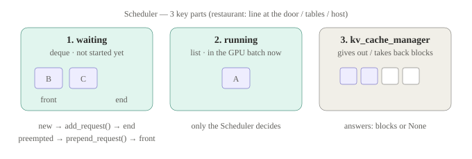

# Scheduler

**Status:** component page, 2026-11-23. Parts re-learned 2026-11-23 (guided). No independent `schedule()` trace yet.
**Main path:** Request → **Scheduler** → KV Cache Manager / BlockPool → Model Runner → GPU
**Source:** [`vllm/v1/core/sched/scheduler.py`](https://github.com/vllm-project/vllm/blob/6ba10507e11c012d40051548c07c10c9bc5971d6/vllm/v1/core/sched/scheduler.py) · [`request_queue.py`](https://github.com/vllm-project/vllm/blob/6ba10507e11c012d40051548c07c10c9bc5971d6/vllm/v1/core/sched/request_queue.py)

| | |
| --- | --- |
| **Owns** | `waiting` (deque: not-started and preempted requests), `running` (list: requests in the batch now), `kv_cache_manager` (a handle to ask for blocks) |
| **Decides** | Who runs this step (token budget, [`max_num_seqs`](../concepts/max-num-seqs.md)), who waits, who is preempted |
| **Asks** | KV Cache Manager: "blocks for this request?" |
| **Called by / sends to** | Engine core calls `schedule()` each step → sends `SchedulerOutput` to the Model Runner |

**Analogy:** the restaurant manager. Decides who sits down and who leaves.

## Key rules

- New request → `add_request()` → **end** of `waiting`.
- Preempted request → `prepend_request()` → **front** of `waiting`.
- Preemption is triggered **only** when a **running** request needs one more block and none are free. A new request that can't fit just waits at the head of `waiting` (FCFS).
- FCFS: the request preempted is the **last** in `running` (can be the same request that needed the block). Its blocks are freed, `num_computed_tokens` → 0.
- After a preemption in a step, no request is admitted from `waiting` in that step.

## Common mix-ups

- ❌ "KV Cache Manager decides who goes to waiting / running." ✅ The Scheduler decides.
- ❌ "A new request can preempt a running one." ✅ Not in default FCFS (priority preemption: Issue #40004).

**Concepts:** [scheduler-and-cache-policy](../concepts/scheduler-and-cache-policy.md) · [memory-bound-and-batching](../concepts/memory-bound-and-batching.md)
