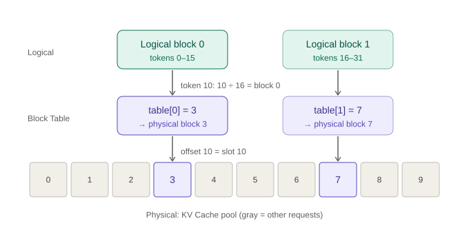

# Block Table and slot mapping

**Status:** concept note, 2026-11-09. Guided explanation plus an assistant-shown source check. **Not** an independent source trace or a test.

**Main path:** Request → Scheduler → KV Cache Manager / BlockPool → **Model Runner** → GPU

## One-sentence idea

Each request has a different length and keeps growing, so the KV Cache in GPU memory is split into fixed-size **physical blocks** that are not contiguous. The **Block Table** translates a token's position into the real **slot** where its K and V are written.

*Concept example (`block_size = 16`), not a trace or measurement.*

## Who does what

| Role | Job |
| --- | --- |
| Scheduler + KV Cache Manager | Decide how many tokens to run; allocate KV blocks |
| Model Runner | Use the token position and the Block Table to find the slot; write K and V there |

The Model Runner needs the new token's position, but it does **not** allocate KV blocks.

## Worked example

Request A has 10 computed tokens, so the new token has position 10 (counting from 0). `block_size = 16`. A's Block Table is `[3, 7]`.

1. Logical block = `10 // 16` = 0; offset = `10 % 16` = 10
2. Physical block = `table[0]` = 3
3. Slot = `3 * 16 + 10` = 58

Block 0 still has free space (offsets 11–15), so no new block is needed in this step.

One cell, two numbers: **10** is the index inside the block (offset); **58** is the global slot index in the whole KV Cache.

## What is written

The token's **K and V** are written to the slot. The token itself is not.

## Analogy

Same idea as an OS page table: logical block = virtual page, physical block = physical page, Block Table = page table.

## Source pointers

Pinned vLLM commit `c2320e3`. Shown by the assistant; the learner has not traced them independently.

- [`ModelRunner.prepare_attn()`](https://github.com/vllm-project/vllm/blob/c2320e37f14420a1157967362b56c899a726d84d/vllm/v1/worker/gpu/model_runner.py#L1658-L1678): gathers block tables and calls `compute_slot_mappings()`.
- [`_compute_slot_mappings_kernel`](https://github.com/vllm-project/vllm/blob/c2320e37f14420a1157967362b56c899a726d84d/vllm/v1/worker/gpu/block_table.py#L402-L409): without context parallel, `block_indices = positions // block_size`, `block_offsets = positions % block_size`, and `slot_ids = block_numbers * block_size + block_offsets`. The multi-group and context-parallel branches are ignored here.

## Still unverified

- Independent trace of `prepare_attn()` by the learner.
- A CPU check.
- Blind retest: see [REVIEW_QUEUE.md](../REVIEW_QUEUE.md).
