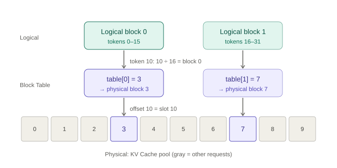

# Block Table and slot mapping

**Status:** concept note, 2026-11-09; small-block example and first learner answer added 2026-11-16 (guided). Guided explanation plus an assistant-shown source check. **Not** an independent source trace or a test.

**Main path:** Request → Scheduler → KV Cache Manager / BlockPool → **Model Runner** → GPU

## One-sentence idea

Each request has a different length and keeps growing, so the KV Cache in GPU memory is split into fixed-size **physical blocks** that are not contiguous. The **Block Table** translates a token's position into the real **slot** where its K and V are written.

*Concept example (`block_size = 16`), not a trace or measurement.*

## Who does what

| Role | Job |
| --- | --- |
| Scheduler + KV Cache Manager | Decide how many tokens to run; allocate KV blocks |
| Model Runner | Use the token position and the Block Table to find the slot; write K and V there |

The Model Runner needs the new token's position, but it does **not** allocate KV blocks.

## Worked example

Request A has 10 computed tokens, so the new token has position 10 (counting from 0). `block_size = 16`. A's Block Table is `[3, 7]`.

1. Logical block = `10 // 16` = 0; offset = `10 % 16` = 10
2. Physical block = `table[0]` = 3
3. Slot = `3 * 16 + 10` = 58

Block 0 still has free space (offsets 11–15), so no new block is needed in this step.

One cell, two numbers: **10** is the index inside the block (offset); **58** is the global slot index in the whole KV Cache.

## Small example (2026-11-16, `block_size = 4`)

A has 8 tokens (pos 0–7) → two groups of 4. Block Table = `[7, 2]`: group 0 → physical block 7 (slots 28–31), group 1 → physical block 2 (slots 8–11).

| pos | group `pos // 4` | physical block | offset `pos % 4` | slot |
| --- | --- | --- | --- | --- |
| 5 | 1 | `table[1]` = 2 | 1 | 2 × 4 + 1 = **9** (shown) |
| 2 | 0 | `table[0]` = 7 | 2 | 7 × 4 + 2 = **30** (learner, right) |

**How to read `Block Table[i] = b`:** "request group *i* is stored in physical block *b*". The index is the request's own group number; the value is the real block number. KV Cache Manager writes it (blocks come from the free-queue front, so they are not in order); Model Runner only reads it.

**Confusions seen:** "5 ÷ 4 = 1" means *group number* (integer division), not a fraction; always count groups and offsets **from 0** (saying "the 2nd block" for group 1 confused the learner).

## Review example (2026-11-17, `block_size = 4`, table `[7, 2, 5]`)

| pos | logical | physical | offset | slot |
| --- | --- | --- | --- | --- |
| 6 | 1 | 2 | 2 | **10** |
| 10 | 2 | 5 | 2 | **22** |
| 11 | 2 | 5 | 3 | **23** |
| 12 | 3 (not in table → new block, e.g. P0) | 0 | 0 | **0** |

**`block_table` vs `slot_mapping`:** `block_table` = one list per request, used to **read** all old K/V. `slot_mapping` = one slot per **new** token this step, used to **write**. In decode it has **1** number per request. Each layer has its own KV cache; a token uses the same slot number in every layer.

**Mistakes seen 2026-11-17:** used the logical block instead of the physical block; used the quotient for offset (it is the **remainder**); treated pos as a 1-based token count.

## What is written

The token's **K and V** are written to the slot. The token itself is not.

## Analogy

Same idea as an OS page table: logical block = virtual page, physical block = physical page, Block Table = page table.

## Source pointers

Pinned vLLM commit `c2320e3`. Shown by the assistant; the learner has not traced them independently.

- [`ModelRunner.prepare_attn()`](https://github.com/vllm-project/vllm/blob/c2320e37f14420a1157967362b56c899a726d84d/vllm/v1/worker/gpu/model_runner.py#L1658-L1678): gathers block tables and calls `compute_slot_mappings()`.
- [`_compute_slot_mappings_kernel`](https://github.com/vllm-project/vllm/blob/c2320e37f14420a1157967362b56c899a726d84d/vllm/v1/worker/gpu/block_table.py#L402-L409): without context parallel, `block_indices = positions // block_size`, `block_offsets = positions % block_size`, and `slot_ids = block_numbers * block_size + block_offsets`. The multi-group and context-parallel branches are ignored here.

Other pointers (names only, not traced):

- nano-vllm: `ModelRunner.prepare_prefill` / `prepare_decode` build `slot_mapping`; `store_kvcache` writes; `BlockManager.may_append` allocates a new block.
- vLLM V1: `BlockTable.compute_slot_mapping` (`vllm/v1/worker/block_table.py`); `KVCacheManager.allocate_slots` allocates new blocks.

## Still unverified

- Independent trace of `prepare_attn()` by the learner.
- A CPU check.
- Blind retest: see [REVIEW_QUEUE.md](../REVIEW_QUEUE.md).
