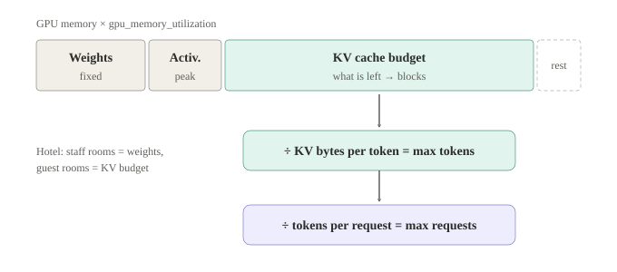

# KV cache memory — formula and capacity

**Component pages:** [kv-cache-manager](../components/kv-cache-manager.md)

**Status:** concept note, 2026-11-17 (guided); × 2, KV heads vs KV cache, and KV budget added 2026-11-23 (guided). Main line item 1. Not yet checked against a real vLLM startup log.

**Main path:** Request → Scheduler → **KV Cache Manager / BlockPool** → Model Runner → GPU

## One-sentence idea

Every token keeps one K and one V vector per KV head per layer, so KV memory grows linearly with tokens; the number of **KV heads** (MHA / GQA / MQA) is the biggest model-side knob.

## Formula

~~~text
per token   = 2 × layers × KV heads × head_dim × bytes
per request = per token × tokens
~~~

`2` = K and V.

## Example (32 layers, head_dim 128, FP16 = 2 bytes)

| Type | KV heads | Per token | 8K tokens |
| --- | --- | --- | --- |
| MHA | 32 | 512 KiB | 4 GiB |
| GQA | 8 | 128 KiB | 1 GiB |
| MQA | 1 | 16 KiB | 0.125 GiB |

Check: 2 × 32 × 32 × 128 × 2 B = 524,288 B = 512 KiB; × 8,192 tokens = 4 GiB.

## Why × 2 (added 2026-11-23)

Each token stores **two** things in every layer: K and V. Both are needed in attention:

1. Q × **K** → scores: which tokens to look at (library: the label on the book spine).
2. scores × **V** → the content to take (library: what is inside the book).

K and V are the same size (KV heads × head_dim), so the formula just multiplies by 2. Without it you count only K, which is half.

## KV heads vs KV cache (added 2026-11-23)

| | KV heads | KV cache |
| --- | --- | --- |
| What | How many K/V groups per layer (a number) | All past tokens' K and V (a block of GPU memory) |
| Set by | Model design (`config.json`, `num_key_value_heads`) | Created at run time |
| Changes? | Never (Llama-3-8B: always 8) | Grows with every token |
| Managed by | — | [KV Cache Manager](../components/kv-cache-manager.md) / [BlockPool](../components/block-pool.md) |

KV heads is **one factor** in the KV cache size. Fewer KV heads (GQA, MQA) → smaller cache. Hotel analogy: KV heads = pages per note (a fixed spec); KV cache = all the notes the guests left in the building.

## KV budget → max requests (added 2026-11-23)

~~~text
KV budget    = GPU memory × gpu_memory_utilization − weights − activation peak
max tokens   = KV budget ÷ KV bytes per token
max requests = max tokens ÷ tokens per request
~~~

Worked step 1 (Qwen2.5-0.5B, FP16: 24 layers, 2 KV heads, head_dim 64): 2 × 24 × 2 × 64 × 2 = 12,288 B ≈ **12 KiB per token**.

## Fit more users on the same GPU — two kinds of quantization (added 2026-11-23)

Rough mental numbers (Llama-3-8B, GQA): **~128 KB per token**, **~0.5 GB per 4K-token request**. On a 24 GB GPU, BF16 weights take ~16 GB, so only ~9 requests of 4K fit.

GPU memory is fixed, so to fit more users you must use less memory per user. Both ways are quantization (fewer bytes per number), on different targets:

| | Quantize what | Effect | vLLM | Hotel |
| --- | --- | --- | --- | --- |
| 1 | **KV cache** → FP8 | Each token smaller; this is the `bytes` in the formula | `--kv-cache-dtype fp8` | Smaller guest rooms |
| 2 | **Weights** → 8-bit / 4-bit | Weights smaller → bigger KV budget | Quantized model (AWQ / GPTQ / FP8) | Smaller staff rooms, more guest rooms |

~~~text
(24 GB GPU, Llama-3-8B, rough)   weights   KV budget   4K users
BF16 weights + FP16 KV            16 GB     ~4.6 GB     ~9
+ KV cache → FP8                  16 GB     ~4.6 GB     ~18
+ weights → 8-bit                  8 GB     ~12.6 GB    ~50
~~~

Other ways (not quantization): a model with fewer KV heads (GQA / MQA); a lower `max_model_len`; prefix caching to share common prefixes. Quantization can cost some accuracy, so test it.

Common mix-up (2026-11-23): "4× users → × 4 in the formula" is how much memory 4× users **need**. The fix is to make each token smaller, not bigger.

## Common confusions

- Forgetting the leading **2** (K and V): gives half the real size (2026-11-23: 64 KiB instead of 128 KiB for Llama-3-8B).
- MHA / GQA / MQA = different **KV head counts**. Blocking is a separate thing (PagedAttention memory management).
- KV heads are **projected** with learned weights (`W_K`, `W_V`), not "split" from one K.
- Weights hold only `W_K`, `W_V`. K and V are per-request results — see [model states](model-states-and-kv-cache.md).

## Where the KV budget comes from (vLLM)

At startup vLLM runs a profiling pass, measures memory for weights + activations, and reserves **the rest** as empty KV blocks.

Why up front, not per request:

1. GPU allocation is slow; a decode step is only a few ms.
2. Avoid fragmentation.
3. The Scheduler needs a fixed total capacity to decide whether to admit a request.

It is **not** for warm-up.

## Next checks

- Paper exercise: M1 Pro 16 GB, a small model — how many 4K-token requests fit at once?
- Later (main line item 4): compare the formula with the KV cache size in a vLLM startup log.

## Reference

- KV Cache Handbook, pp. 7–9.
