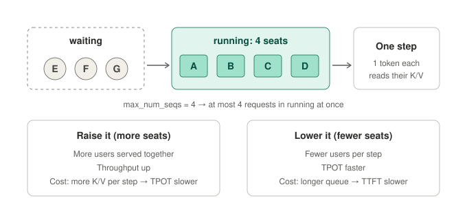

# `max_num_seqs` — how many requests run at once

**Status:** taught 2026-11-24 (guided). 3rd knob for the Colab gate check **延迟检查 (TTFT vs TPOT)**. Formal pass: none.
**Main path:** Request → **Scheduler** (`running` seats) → KV Cache Manager / BlockPool → Model Runner → GPU decode step
**Component pages:** [scheduler](../components/scheduler.md)

## One sentence

`max_num_seqs` is the max number of requests in `running` at the same time.

一句话中文：`running` 里最多能坐几个人。座位多 → 一起服务的人多，但每一步要读的 K/V 更多 → 每个字更慢；座位少 → 每个字更快，但排队的人要等更久才能开始。

## Why it matters at work

`--max-num-seqs` is one of the first flags people tune in `vllm serve`. When users say "every word is slow" and there are no long prompts, this is often the knob.

## Two knobs — elevator analogy

| Knob | Limits | Elevator |
| --- | --- | --- |
| [`max_num_batched_tokens`](ttft-vs-tpot.md) | **Tokens** per step | Weight limit (限重) |
| `max_num_seqs` | **Requests** per step | Head count (限乘人数) |

A 10,000-token document is **one** request — one very heavy person. Only the weight limit can control it.

## The mechanism (the part missed 2×)

Each decode step reads the K/V of **every running user** (weights are read once and shared). More seats → more K/V per step → each step takes longer → TPOT slower. See [memory-bound-and-batching](memory-bound-and-batching.md).

## Symptom → knob

| User complaint | Cause | Knob |
| --- | --- | --- |
| First word is slow (long prompts) | Too little prefill per step | **Raise** `max_num_batched_tokens` |
| Chat stutters when a long document arrives | Too much prefill per step | **Lower** `max_num_batched_tokens` / chunked prefill |
| Every word is always slow (many users, no long prompts) | Too many users' K/V read per step | **Lower** `max_num_seqs` |

Cost of lowering `max_num_seqs`: more requests wait in `waiting` → their TTFT goes up; total throughput goes down.

## Answered (2026-11-24)

| Q | Case | Answer | Result |
| --- | --- | --- | --- |
| Q1 | `max_num_seqs` 4, `running` = [A, B, C, D], new E, plenty of free blocks | E stays in `waiting`; no preemption — preemption only happens for running requests, and running is full | **Right, first try, no hint** |
| Q2 | 200 chat users, no long prompts, `waiting` empty, every word slow | Lower `max_num_seqs`; cost: other users wait. "Waiting empty → all 200 are running" | Knob + direction + cost **Right, first try**. Reason **Partial**: said "the setting is too high" (conclusion), not the mechanism |
| Q3 | Why does lowering it make each word faster? | "20 → 5 requests at once; in decode, less K/V to read → faster" | **Right · own words** (after the explanation) |
| Q4 | Chat stutters only when a 10,000-token document arrives | Chose `max_num_seqs`, lower; reason "less prefill per step" | **Miss** on the knob (reason describes `max_num_batched_tokens`); direction right |
| Q4b | Why can't lowering `max_num_seqs` fix it? | "It only cuts how many requests run; one big request is still big" | **Right · own words** (guided, after the correction) |
