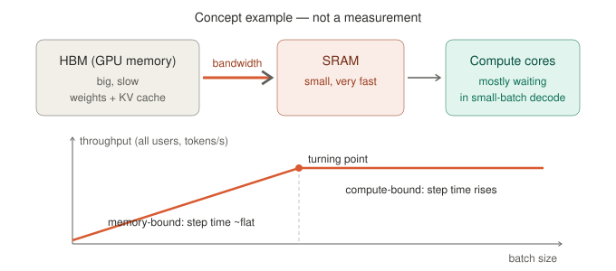

# Memory-bound decode and batching

**Component pages:** [scheduler](../components/scheduler.md)

**Trunk position:** GPU execution step after the Model Runner. Explains *why* the Scheduler's batch size (`max_num_seqs`, token budget) and KV space matter for speed and cost. SKILL_MAP row: *Prefill vs decode; compute vs bandwidth* (P0).

*Concept example only — no GPU measurement.*

## Core idea (one line)

**Decode is slow because moving data is slow, not because math is slow.**

- Each decode step reads **all model weights** + **each request's own KV cache** from **HBM** (GPU memory) to the compute cores. This is inside the GPU, **not** CPU → GPU (that is PCIe / KV offload, a different topic).
- **Batching:** weights are read **once** and shared by every request in the batch; KV cache is **per request** and cannot be shared (except prefix-cache blocks).
- Small batch → **memory-bound** (cores wait). Bigger batch → throughput rises almost for free. Past the **turning point** → **compute-bound**: throughput flattens and each step gets slower.

## Both phases move data — "bound" means which part takes longer (added 2026-11-27)

| Kitchen | GPU |
| --- | --- |
| chef's hands + knife (cut) | compute units (math) |
| cutting board — small, right next to the hands | **SRAM** — tiny (MBs), very fast |
| fridge — big, a few steps away | **HBM** — big (e.g. 80 GB), slower; weights + KV cache live here |

- **Prefill:** walk to the fridge **once** (weights HBM → SRAM), then cut **all 2,000 prompt tokens** → the hands are the limit → **compute-bound**.
- **Decode:** walk to the fridge **every step** (all weights + every user's K/V), cut **1 token** per user → the walking is the limit → **memory-bound**.
- Common mistake (11-27): "prefill moves no data". Both phases move data; the bound is whichever takes longer — the moving or the math. SRAM / HBM are fast / slow **storage**, not fast / slow compute.

## Two metrics — do not mix them

| Metric | Who cares | Meaning |
| --- | --- | --- |
| Throughput (tokens/s, all users) | Operator / cost | How much the whole GPU produces |
| TPOT (time per output token) | Each user | How fast *their* text appears |

Analogy: a kitchen. Throughput = dishes per hour for the whole restaurant; TPOT = how long **your table** waits for the next dish.

## Choosing batch size

- **Interactive chat:** left of the turning point, as close to it as possible — TPOT stays about the same, throughput is higher.
- **Offline batch job (nobody waiting):** as large as KV memory allows; the real limit is KV cache filling GPU memory, and vLLM preempts when it does (see [scheduler note](scheduler-and-cache-policy.md)).

Knobs in vLLM: [`max_num_seqs`](max-num-seqs.md), `gpu_memory_utilization`, `max_num_batched_tokens`.

## Next

Compute the turning point with numbers: **arithmetic intensity** (FLOPs per byte moved) vs the GPU's FLOPs/bandwidth ratio — the **roofline model**. Reading: kipply's *Transformer Inference Arithmetic*.
