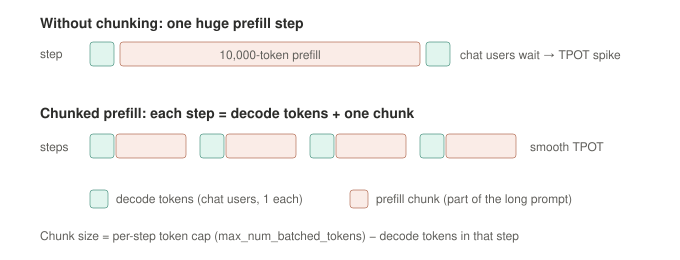

# Model Runner inputs and chunked prefill

**Component pages:** [model-runner](../components/model-runner.md)

**Trunk position:** `SchedulerOutput` → **Model Runner** → GPU forward. Builds on [Scheduler token budget](scheduler-and-cache-policy.md) and [Block Table / slot mapping](block-table-and-slot-mapping.md). Concept only — no source trace yet.

## Why it matters at work

When production vLLM misbehaves (garbled output, one slow step, CUDA error), the first place to look is **what the Model Runner fed the GPU this step**.

## Flattened batch (continuous batching, concretely)

The Scheduler says *who runs and how many tokens each*. The Model Runner joins all scheduled tokens into **one flat list** — prefill and decode mixed, no padding — and runs **one forward pass**.

Example: A has 10 computed tokens and decodes 1; B is new and prefills 4.

| | A | B | B | B | B |
| --- | --- | --- | --- | --- | --- |
| `input_ids` | A's next token ID | B1 | B2 | B3 | B4 |
| `positions` | 10 | 0 | 1 | 2 | 3 |

- `input_ids` = each token's **ID in the vocabulary** (from the tokenizer) — *which* token. Not a sequence number.
- `positions` = where the token sits **in its own request**, counted from 0 — *where* it is.
- `slot_mapping` = where its K/V is written (Block Table formula).

Wrong positions → wrong output. Too many tokens in one step → slow step.

## Chunked prefill

`max_num_batched_tokens` = seats per step (tokens), **not** number of requests (`max_num_seqs`).

With 8 seats, A decoding 1 and B's prompt = 20: B gets 7, 7, then 6 tokens over 3 steps. A never pauses. Each chunk writes its K/V to the cache; the next chunk attends to it. B's first output token appears after the last chunk.

| `max_num_batched_tokens` | Effect |
| --- | --- |
| Larger | Long prompts reach first token sooner (better TTFT); running users may stutter (worse TPOT spikes) |
| Smaller | Running users smooth; long prompts wait longer for first token |

Rule of thumb: **TTFT slow → more seats; TPOT stutter → fewer seats.** Prefill of many tokens is compute-heavy, so this is not the memory-bound decode story.

## Next proof

Learner locates in source where the runner builds `input_ids` / `positions` for a step (file + function to be given), and predicts the arrays for a new A/B case.

## Chunked prefill — the key point (added 2026-11-23)

- **One sentence:** split a long prompt into chunks, and run each chunk **in the same step as the decode tokens** of users who are already chatting.
- **Why:** without chunking, one huge prefill step makes chat users wait (TPOT spike). With chunking, every step still gives each chat user its next token.
- **Chunk size** is not a fixed count: it is the per-step token cap (`max_num_batched_tokens`) minus the decode tokens already in that step.
- **Trade-off:** the long prompt needs more steps, so its own TTFT is a bit slower; chat users get smooth TPOT.
- Elevator: each trip carries one batch of the 10,000 people **plus** the people waiting on other floors.

**Learner restatement (2026-11-23):** "a long prompt makes users stuck; with chunks, the user prefills a piece, then decodes a piece, then prefills, then decodes, so TPOT is smooth" → **Partial**: smooth TPOT is right, but it is **two different users** in each step — the long-prompt request does the prefill chunk; the **other**, already-chatting users do the decode. The long-prompt request does not decode until all its chunks are done.

**Q: with chunking, does the long-prompt user's TTFT get faster or slower?** Learner: "slower, because it still has to wait for prefill to finish" (吧) → **Partial**: conclusion right; the reason is also true *without* chunking, so it does not explain the change. Missing: the prefill is spread over **more steps**, and each step also carries other users' decode tokens, so the whole prefill finishes later.
