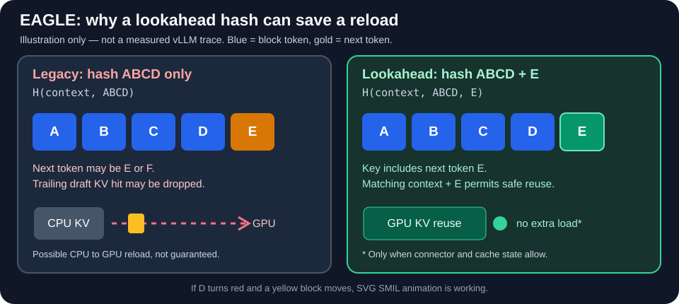

# Speculative Decoding and EAGLE

**Level:** EAGLE trailing-block drop **Verified (concept only)** on 2026-11-04. Lookahead Hash **Explained (guided)**; independent next-day recall pending. General speculative decoding and code-level implementation remain at **Explained**.

## Basic idea

Normal generation runs a large model one token at a time.

Speculative decoding uses a fast **drafter** to propose multiple candidate tokens. The **target model** then checks several positions in one forward pass. Accepted tokens advance generation, reducing the number of sequential target steps.

The draft does **not** replace target-model verification. With the correct acceptance algorithm, stochastic speculative decoding preserves the target distribution.

Speedup is **not guaranteed**. A slow drafter, low acceptance rate, or expensive verification can remove the benefit.

## What makes EAGLE different?

EAGLE uses target-model hidden-state features in a lightweight drafting network. It is more specific than the generic picture of a separate small language model.

A deployment can load a target model and an EAGLE draft component inside one vLLM service, potentially on one GPU if memory allows.

## Why the last prefix block matters

For EAGLE-style drafters, the draft KV at a block's last position can depend on the token after that block.

Consider block size 4:

~~~text
Request 1: [A B C D] E
Request 2: [A B C D] F
~~~

A legacy hash of `ABCD` matches both requests. But the cached **draft** KV may differ because the next token is E in one case and F in the other.

The conservative legacy approach drops the trailing cache-hit unit and recomputes it. This does **not** necessarily erase the physical block.

**Lookahead hashes** include the relevant following token(s) in the cache key. This can make safe reuse possible without an automatic trailing-block drop.

## Animated teaching example

The comparison shows why `H(context, ABCD)` is not enough for the EAGLE draft boundary when `E` or `F` follows. A supported lookahead key includes the next token ID. It does **not** compare draft KV values directly.

This is a simplified concept, not a runtime test or benchmark. Research status (2026-11-04): PRs [#61589](https://github.com/vllm-project/vllm/pull/61589) and [#64096](https://github.com/vllm-project/vllm/pull/64096) are merged; [Issue #65161](https://github.com/vllm-project/vllm/issues/65161) still needs current-main verification (see [issue note](../issues/vllm-65161.md)).

## Understanding evidence — 2026-11-04

The learner independently explained: with block size 4, a cached block ending in H can have different **EAGLE draft KV at H** when the following token is X in one request and Y in another. Therefore matching EFGH alone does not prove the trailing draft KV is reusable. This is the correct reason for the *legacy* conservative block drop.

Important distinction: the **target model's KV for EFGH** remains reusable when its preceding context is identical; it is the **draft-side boundary state** that may differ. Dropping a cache hit does not mean its physical memory was corrupted or erased.

**Verification limit:** The explanation was checked in conversation, not against a user-written source trace or a running test. Do not mark code-level proficiency as verified.

## Lookahead Hash learning evidence — 2026-11-04

For block size 4 and lookahead 1, the learner identified the fifth Token (T5) as the known next token after the four-token block. After correction, they recognized that the cache lookup compares a **single combined hash** (illustrated as `Hash(ABCDE)`), not a separate hash for E and not E's Draft KV.

**Initial confusion worth reviewing:** At first the learner described matching the next token's *draft KV*. The correct condition is that the next token **ID** participates in the combined cache key; matching the token and context helps establish that the draft-side boundary state is reusable.

**Evidence limit:** This was guided learning with multiple checks. A new independent, closed-book example is scheduled for 2026-11-05. Not code-verified.

## Understanding checks

1. What is the difference between a draft proposal and a target verification?
2. Why does a legacy hash of `ABCD` not prove that an EAGLE draft KV made with `E` is safe for `ABCD + F`?
3. Why is better cache reuse not automatically faster under every workload?

## References

- [Lookahead local hashes: PR #61589](https://github.com/vllm-project/vllm/pull/61589)
- [Lookahead KV connector support: PR #64096](https://github.com/vllm-project/vllm/pull/64096)
- [vLLM speculative configuration](https://github.com/vllm-project/vllm/blob/main/vllm/config/speculative.py)
