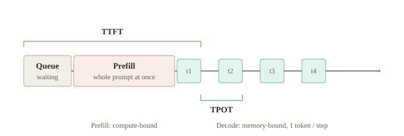

# TTFT vs TPOT — what limits each

**Status:** concept started 2026-11-23 (picture shown, first question open). Main line item 2. Colab gate check **B**.
**Main path:** Request → Scheduler → KV Cache Manager / BlockPool → Model Runner → **GPU** (prefill / decode steps)
**Component pages:** [scheduler](../components/scheduler.md) · [model-runner](../components/model-runner.md)

## One sentence

TTFT (time to first token) is how long the user waits before the first word; TPOT (time per output token) is how fast the next words come. They are limited by different things.

## Why it matters at work

Most latency complaints are one of two: "it takes long to start" (TTFT) or "the text comes out slowly" (TPOT). You must know which knob fixes which — this is the learner's weak pattern **B (direction)** in [MISTAKES.md](../MISTAKES.md).

Restaurant: TTFT = wait for the first dish (the kitchen reads the whole order first); TPOT = time between dishes.

## So far

- TTFT = queue wait + **prefill** (whole prompt in one go, compute-bound).
- TPOT = one **decode** step per token (memory-bound — see [memory-bound-and-batching](memory-bound-and-batching.md)).

## Open question (2026-11-23)

A 10,000-token prompt: does TTFT or TPOT get slower, and why?
