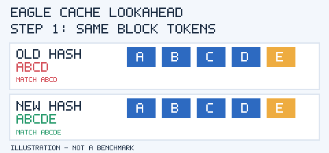

# EAGLE Lookahead Hash — Animation and HTML Rendering Test

## Animated GIF in GitHub Markdown

Expand the explanation (GitHub HTML test)

- A legacy key `H(context, ABCD)` can match two requests that have different next tokens.
- EAGLE draft KV at the boundary may depend on next token `E` or `F`.
- The old path may exclude the trailing GPU hit. CPU offloading can then load that block.
- Lookahead uses a combined key such as `H(context, ABCD, E)`. When the context and E match, reuse is safer.
- This is a **simplified example**. It does not show that every CPU reload disappears.

## Full HTML animation

See [eagle-lookahead.html](eagle-lookahead.html). It is a self-contained HTML/CSS file. GitHub's normal file viewer displays its **source**, not a live animated webpage. Open it locally in a browser or publish through GitHub Pages to run CSS animations.

## GitHub display support

GitHub supports GIF images in Markdown. It also supports a limited set of HTML elements, including expandable `
` and images. GitHub's official [file documentation](https://docs.github.com/en/repositories/working-with-files/using-files/working-with-non-code-files) says SVG animation is not supported in its normal SVG viewer. The repo also has a [separate SVG compatibility test](../assets/kv-cache-smil-test.svg) so we can see what this client renders.

## Research status

PRs [#61589](https://github.com/vllm-project/vllm/pull/61589) and [#64096](https://github.com/vllm-project/vllm/pull/64096) are merged. The original [Issue #65161](https://github.com/vllm-project/vllm/issues/65161) still needs current-main verification. **No benchmark or new fix has been run here.**

**Next:** trace `FullAttentionManager → Scheduler → OffloadingConnector`, build a regression test, and compare actual transfers and TTFT before writing a PR.